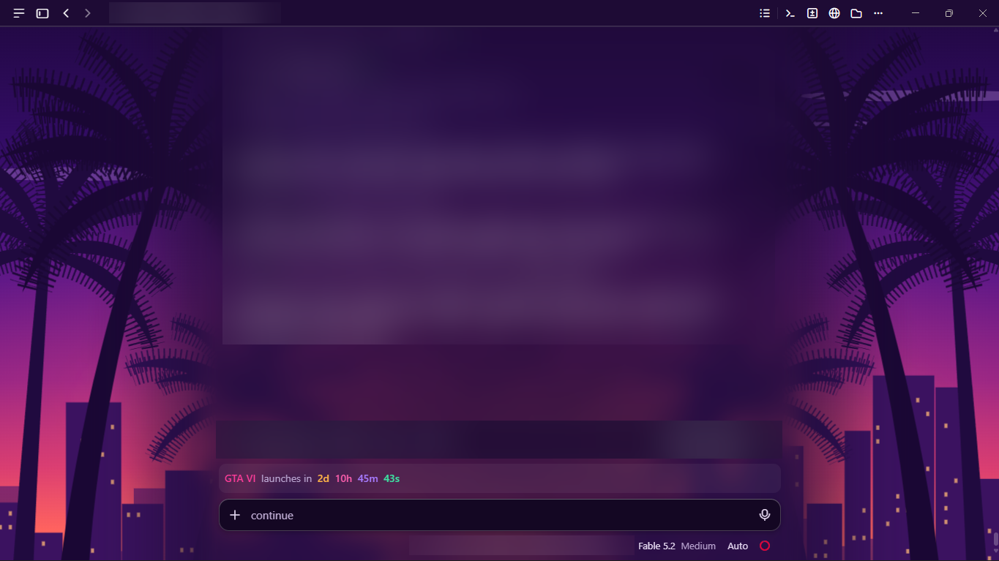

# Vice Sunset

A GTA VI-inspired look for Claude Code in the Claude desktop app: a deep-purple sky fading to a pink-orange sunset, palm silhouettes on both edges, a distant skyline with flickering windows, slow drifting haze, plum frosted panels, white text and neon-pink accents. It also adds a slim countdown above the message box. Original art; not affiliated with Rockstar Games.



## Install

At the prompt of a Claude Code session:

```
/plugin install vice-sunset --marketplace RanaRomdhane/vice-sunset
```

Answer `y` to add the marketplace, then pick a scope (user scope applies it to every session).

From a shell:

```bash
claude plugin install vice-sunset --marketplace RanaRomdhane/vice-sunset
```

## Options

Set them in the Claude Code config menu, or under `pluginConfigs["vice-sunset"].options` in `~/.claude/settings.json`:

- `showCountdown` (true): show or hide the countdown row
- `countdownLabel` ("GTA VI"): the pink word at the start of the row
- `countdownTarget` ("2026-11-19T00:00:00Z"): ISO 8601 date; add an offset such as `-05:00` to pin a timezone
- `animate` (true): turn off for a still scene (it also stops when the OS asks for reduced motion)

## Notes

- Drawn by the desktop and mobile apps' Claude Code sessions only. Terminals, editors and the regular Chat tab aren't themed.
- Dark mode only: it's a dusk scene.
- To revert, disable or uninstall the plugin: `claude plugin uninstall vice-sunset`.
